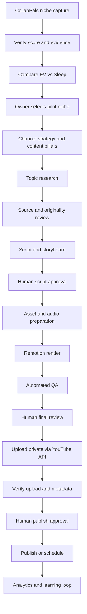

# PRD — YouTube Auto Content Studio
## Electric Vehicles & Sleep Content | CollabPals Niche Score–Driven

**Versi:** 1.0  
**Tanggal:** 30 Oktober 2026  
**Status:** Draft implementasi — menunggu validasi skor niche aktual  
**Nama produk kerja:** YouTube Auto Content Studio

---

## 1. Ringkasan Eksekutif

YouTube Auto Content Studio adalah sistem produksi konten YouTube berbantuan AI yang mengelola riset niche, ide, naskah, aset visual/audio, rendering video, pemeriksaan kualitas, dan upload ke YouTube.

Sistem memulai dengan dua kandidat niche yang harus dinilai menggunakan data aktual dari:

https://www.collabpals.com/tools/youtube-niche-finder

1. **Electric Vehicles (EV):** edukasi kendaraan listrik, teknologi baterai, charging, perbandingan, kepemilikan, industri, dan perkembangan pasar.
2. **Sleep Content:** original sleep soundscape, ambience, nature sound, white noise, relaxing visual loops, dan konten pendukung tidur.

Sistem tidak boleh mengarang skor CollabPals. Skor dan atribut niche wajib diambil dari tool tersebut, disimpan bersama bukti pengambilan dan timestamp, lalu digunakan sebagai input keputusan. Jika skor tidak berhasil diperoleh, status niche adalah `unverified`, bukan diberi skor perkiraan.

**Prinsip produk:** otomatisasi proses produksi, bukan produksi massal konten generik. Setiap video harus memiliki nilai orisinal, lisensi aset yang jelas, pemeriksaan fakta/kualitas, dan approval manusia sebelum dipublikasikan.

## 2. Tujuan Produk

### 2.1 Tujuan utama

- Mengurangi waktu manual untuk membuat video YouTube.
- Memvalidasi dan membandingkan niche EV dengan Sleep Content menggunakan skor CollabPals aktual.
- Mengelola pipeline produksi dari riset sampai upload.
- Menghasilkan video long-form dan Shorts.
- Mengelola beberapa channel secara terpisah agar audiens EV dan Sleep tidak tercampur.
- Menggunakan Hermes sebagai orchestrator/assistant yang dapat dikendalikan melalui Telegram.
- Membangun sistem yang dapat ditingkatkan dari assisted workflow menuju otomasi lebih tinggi dengan approval gates.

### 2.2 Sasaran bisnis awal

Target operasional awal, bukan jaminan performa:

- 1 channel pilot terlebih dahulu setelah niche dipilih.
- 1–2 long-form per minggu.
- 2–4 Shorts per minggu yang berasal dari riset atau video long-form dengan adaptasi editorial.
- Menghasilkan 10 video pilot sebelum meningkatkan volume.
- Mengukur retention, CTR, watch time, subscriber conversion, dan biaya produksi per video.

### 2.3 Bukan tujuan MVP

- Menjalankan banyak channel secara massal.
- Menghasilkan video tanpa pemeriksaan manusia.
- Menjamin monetisasi atau jumlah views tertentu.
- Mengambil konten kompetitor lalu mengunggah ulang.
- Menggunakan musik, footage, atau suara tanpa lisensi.
- Memublikasikan konten secara otomatis tanpa approval.

## 3. Dasar Niche Scoring: CollabPals

### 3.1 Sumber wajib

URL:
`https://www.collabpals.com/tools/youtube-niche-finder`

Halaman tool menyebut:
- 200+ niche.
- Niche Score 0–100.
- Demand: 30%.
- Competition: 40%.
- Monetization: 30%.
- Faceless-friendly filter.
- Equipment indicator.
- Sub-niche explorer.
- Skor di atas 70 disebut sebagai indikator yang baik untuk channel baru.

Sumber penjelasan:
`https://www.collabpals.com/tools/youtube-niche-finder`

**Catatan validasi:** halaman publik yang dapat dibaca secara statis menyatakan database niche memerlukan JavaScript. Oleh karena itu, angka EV dan Sleep belum ditetapkan di dokumen ini. Sistem harus mengambil nilai aktual melalui browser automation yang menampilkan halaman sebagaimana pengguna melihatnya, atau menerima input manual terverifikasi. Jangan mengandalkan angka hasil tebakan atau scraping endpoint internal yang tidak didokumentasikan.

### 3.2 Data yang wajib dikumpulkan

Untuk masing-masing kandidat, simpan:

| Field | Keterangan |
|---|---|
| `source_name` | CollabPals YouTube Niche Finder |
| `source_url` | URL tool |
| `niche_name` | Nama niche persis seperti ditampilkan |
| `matched_query` | Kata pencarian yang dipakai, mis. Electric Vehicles / Sleep |
| `niche_score` | Skor total 0–100 |
| `demand_score` | Jika ditampilkan |
| `competition_score` | Jika ditampilkan |
| `monetization_score` | Jika ditampilkan |
| `cpm_range` | Estimasi CPM jika tersedia |
| `growth_trend` | Rising / stable / declining / unknown jika tersedia |
| `faceless_friendly` | Boolean/unknown |
| `equipment_level` | Phone / basic / professional / unknown |
| `sub_niches` | Daftar sub-niche yang tersedia |
| `captured_at` | Timestamp UTC |
| `evidence_screenshot` | Screenshot hasil |
| `evidence_text` | Data teks/DOM yang diekstrak |
| `capture_method` | Browser automation / manual |
| `verification_status` | verified / needs_review / unverified |
| `notes` | Catatan reviewer |

Jika tool hanya menampilkan total score dan tidak memaparkan nilai komponennya, simpan komponen sebagai `null`. Jangan menghitung ulang atau mengarang nilai komponen.

### 3.3 Metode pengambilan data

**Pilihan utama: Playwright browser capture**

1. Jalankan browser worker dengan Chromium.
2. Buka URL CollabPals.
3. Tunggu halaman dan komponen niche selesai dimuat.
4. Cari kandidat dengan kata kunci:
   - `Electric Vehicles`
   - `EV`
   - `Sleep`
   - `Sleep Content`
   - `Meditation`
   - `Relaxation`
   - `Ambient`
   - `ASMR` bila relevan.
5. Ambil nama niche persis, score, atribut yang terlihat, dan sub-niche.
6. Simpan screenshot sebagai bukti.
7. Minta verifikasi reviewer bila hasil ambigu.
8. Catat waktu capture dan versi parser.

**Fallback manual:**
- Admin membuka tool.
- Memasukkan nilai yang tampil ke form.
- Mengunggah screenshot.
- Sistem memberi status `needs_review` sampai reviewer menyetujui.

**Ketentuan integrasi:**
- Jangan bypass CAPTCHA, login, paywall, atau mekanisme proteksi.
- Jangan reverse-engineer atau memanggil endpoint privat yang tidak didokumentasikan.
- Terapkan rate limit konservatif dan cache hasil.
- Jika markup berubah, tandai `capture_failed` dan jangan memakai skor lama seolah-olah baru.
- Hormati Terms of Service dan robots/access restrictions yang berlaku.
- Simpan sumber dan timestamp untuk audit.

### 3.4 Decision engine

Niche Score dari CollabPals adalah sinyal awal, bukan satu-satunya penentu keputusan. Decision engine memiliki dua lapisan:

**Lapisan A — CollabPals score**

- `>= 70`: kandidat kuat untuk validasi lanjutan.
- `60–69`: layak diuji jika sub-niche dan format punya diferensiasi.
- `< 60`: jangan dipilih otomatis; perlu alasan bisnis kuat.
- `unverified`: tidak boleh menjadi pemenang otomatis.

Threshold di atas mengikuti panduan umum yang ditampilkan CollabPals; bukan jaminan pertumbuhan.

**Lapisan B — Internal pilot score (0–100)**

| Faktor | Bobot | Metode |
|---|---:|---|
| CollabPals Niche Score | 40% | Nilai score aktual / 100 |
| Content feasibility | 20% | Kemampuan membuat 20 ide orisinal dan aset legal |
| Audience validation | 20% | Search demand, komentar audiens, kompetitor, pertanyaan berulang |
| Production economics | 10% | Biaya dan waktu produksi per video |
| Monetization diversification | 10% | Sponsor, affiliate, produk, layanan selain ads |

Rumus:
`internal_score = 0.40 * niche_score + 0.20 * feasibility + 0.20 * audience_validation + 0.10 * production_economics + 0.10 * monetization_diversification`

Komponen selain CollabPals dinilai 0–100 oleh reviewer dengan bukti. Jika `niche_score` belum verified, internal score tidak boleh dianggap final.

**Aturan keputusan:**
- Pilih satu niche untuk channel pilot.
- Jangan menggabungkan EV dan Sleep dalam satu channel.
- Jika skor keduanya dekat (selisih < 5), lakukan pilot editorial 3 video per niche sebelum memutuskan.
- Jika satu niche lebih tinggi ≥ 5 poin dan lolos feasibility, jadikan kandidat utama.
- Keputusan final tetap memerlukan persetujuan owner.
- Simpan riwayat skor; jangan overwrite snapshot sebelumnya.

## 4. Persona dan Pengguna

### 4.1 Owner / Admin
- Mengelola channel dan koneksi OAuth.
- Menentukan niche prioritas.
- Menyetujui riset, script, render, dan publikasi.
- Melihat biaya, performa, dan audit log.

### 4.2 Content Researcher / AI Agent
- Mengumpulkan sumber.
- Mengidentifikasi topik dan pertanyaan audiens.
- Membuat outline dengan citation ledger.
- Menghasilkan brief konten.

### 4.3 Script Editor / AI Agent
- Membuat naskah dan metadata.
- Memastikan orisinalitas, alur, dan audience fit.
- Tidak boleh membuat klaim faktual tanpa sumber.

### 4.4 Producer / Renderer
- Menggabungkan voiceover, visual, sound design, captions, dan scene.
- Membuat render melalui Remotion.

### 4.5 QA Reviewer
- Memeriksa fakta, hak cipta, audio, visual, subtitle, dan kualitas render.
- Menolak hasil yang tidak memenuhi checklist.

### 4.6 Hermes Agent
- Menjadi interface conversational melalui Telegram.
- Memanggil API Content Studio.
- Memberi ringkasan pekerjaan dan meminta approval.
- Tidak menyimpan OAuth refresh token atau API secret di prompt/chat.
- Tidak dapat melewati approval gate.

## 5. Ruang Lingkup MVP

### 5.1 In scope

1. Multi-niche workspace untuk EV dan Sleep.
2. CollabPals score capture dan evidence storage.
3. Niche comparison dashboard.
4. Channel profile dan content strategy.
5. Topic research dan idea backlog.
6. Script generation dan source citations.
7. Asset management dengan lisensi/provenance.
8. Voiceover generation atau upload audio.
9. Remotion template engine.
10. Long-form dan Shorts output profiles.
11. Captions/subtitles.
12. Thumbnail dan metadata generation.
13. Quality assurance checklist.
14. Approval workflow.
15. YouTube OAuth 2.0 dan resumable upload.
16. Upload default `private`.
17. Analytics dasar dari YouTube Data API/YouTube Analytics API jika scope tersedia.
18. Hermes API integration.
19. Queue, retry, logs, dan audit trail.

### 5.2 Out of scope MVP

- Auto-publication tanpa persetujuan.
- Auto-commenting, auto-like, auto-subscribe.
- Re-upload atau scraping video kompetitor.
- Music generation yang meniru artis/lagu tertentu.
- Otomatis mengkloning suara orang tanpa izin.
- Menghasilkan klaim medis tentang manfaat tidur atau menyembuhkan insomnia.
- Prediksi pendapatan yang dianggap pasti.
- Pengelolaan iklan berbayar.

## 6. Strategi Konten per Niche

### 6.1 Electric Vehicles

**Positioning yang disarankan:** practical, evidence-led EV explainers for curious buyers and technology enthusiasts.

**Sub-niche untuk dievaluasi:**
- EV battery technology explained.
- EV ownership cost and maintenance.
- Charging infrastructure and charging myths.
- EV vs hybrid comparisons.
- Battery degradation and battery lifespan.
- New EV models and industry developments.
- EV technology for beginners.
- Used EV buying guides.

**Format long-form:**
- Explainer 8–14 menit.
- Comparison 8–12 menit.
- Deep dive 12–18 menit.
- Monthly industry recap 8–12 menit.

**Format Shorts:**
- Satu fakta/konsep dengan konteks dan sumber.
- Mitos vs fakta.
- Satu istilah teknologi dalam 30–60 detik.
- Potongan insight dari video panjang yang diedit ulang dengan struktur Shorts.

**Research rules:**
- Prioritaskan sumber primer: pabrikan, regulator, lembaga keselamatan, paper ilmiah, laporan resmi, dan dokumentasi teknis.
- Berita terbaru harus memiliki tanggal publikasi dan tanggal kejadian.
- Bedakan spesifikasi resmi, klaim pabrikan, hasil pengujian pihak ketiga, dan opini.
- Angka range, charging time, battery capacity, dan harga harus menyertakan konteks pasar, model, varian, kondisi pengujian, dan tanggal.
- Jangan menyatakan semua EV memiliki karakteristik yang sama.
- Jangan menggunakan visual kendaraan/model yang salah untuk mendukung klaim spesifik.

### 6.2 Sleep Content

**Positioning yang disarankan:** original, carefully produced sleep and relaxation soundscapes with distinct sound design and visual identity.

**Sub-niche untuk dievaluasi:**
- Rain ambience.
- Ocean and waves.
- Forest night ambience.
- Fireplace and cabin ambience.
- Brown noise / white noise.
- Airplane/train ambience.
- Dark-screen sleep soundscapes.
- Long-form nature soundscapes.

**Format:**
- Long-form 1–3 jam pada MVP; durasi lebih panjang setelah uji kualitas dan biaya.
- Visual ambience original, subtle animation, atau footage berlisensi.
- Audio stereo yang bersih, konsisten, tanpa abrupt peaks.
- Optional black-screen variant jika ada alasan audience yang tervalidasi.
- Shorts hanya untuk discovery/preview; bukan sekadar memotong video panjang tanpa konteks.

**Sleep content rules:**
- Semua audio harus original, berlisensi, atau berasal dari sumber yang secara eksplisit mengizinkan penggunaan komersial dan monetisasi.
- Simpan bukti lisensi, sumber, tanggal download, dan syarat atribusi.
- Jangan mengulang satu audio pendek secara kasar menjadi video berjam-jam tanpa desain soundscape yang bermakna.
- Hindari klaim medis seperti “menyembuhkan insomnia”, “menghilangkan anxiety”, atau klaim efek gelombang otak yang tidak terbukti.
- Lakukan loudness, clipping, silence, loop seam, dan headphone QA.
- Konten antarvideo harus memiliki perbedaan kreatif yang nyata: komposisi, sound layers, ambience, durasi, visual, dan pengalaman pendengar.

### 6.3 Channel separation

- EV dan Sleep wajib menjadi channel terpisah.
- Setiap channel memiliki brand, audience persona, metadata defaults, playlist, dan content calendar sendiri.
- Jangan menerbitkan Sleep ambience pada channel EV atau sebaliknya.
- MVP boleh mengelola kedua kandidat, tetapi produksi aktif dimulai dari satu channel pemenang.

## 7. Workflow End-to-End



### Workflow status

`draft → researching → research_review → scripting → script_review → asset_preparation → rendering → qa_review → final_approval → upload_pending → uploaded_private → publish_approval → scheduled/published → analytics`

Status tambahan:
- `blocked`
- `failed`
- `cancelled`
- `rejected`
- `needs_revision`

Setiap perubahan status harus memiliki actor, timestamp, reason, dan event log.

## 8. Functional Requirements

### FR-001 — Niche Registry
- Admin dapat membuat kandidat niche.
- Default candidates: Electric Vehicles dan Sleep Content.
- Setiap niche mempunyai deskripsi, audience, sub-niche, channel intent, dan status.
- Niche tidak dapat dipromosikan menjadi `selected` tanpa verified CollabPals snapshot.

### FR-002 — CollabPals Capture
- Browser worker dapat membuka tool dan melakukan pencarian.
- Capture nama niche persis, score, atribut yang tersedia, sub-niche, screenshot.
- Parser harus mengembalikan confidence dan versi parser.
- Jika hasil ambigu atau selector gagal, tandai `needs_review`.
- Admin dapat melakukan manual entry dengan screenshot.
- Snapshot tidak boleh diedit setelah verified; koreksi dibuat sebagai snapshot baru.
- Sistem menampilkan umur data dan memberi peringatan jika lebih dari 30 hari.

### FR-003 — Niche Decision Dashboard
- Bandingkan EV dan Sleep.
- Tampilkan total score, komponen yang tersedia, CPM range, trend, faceless suitability, equipment.
- Tampilkan source URL dan timestamp.
- Tampilkan internal score dan breakdown.
- Tampilkan missing data secara eksplisit.
- Minta owner approval untuk menetapkan niche pilot.

### FR-004 — Channel Management
- Kelola channel terpisah.
- Simpan channel ID, nama, bahasa, negara target, timezone, brand kit, default visibility.
- OAuth token dienkripsi.
- Channel tidak dapat mengakses token channel lain tanpa permission.

### FR-005 — Topic Research
- Input niche/sub-niche, audience, language, region, format, target duration.
- Buat 10–20 ide per batch.
- Setiap ide mempunyai angle, promise, target viewer, novelty note, keyword, dan source leads.
- Hindari duplikasi topik dari video sebelumnya.
- Ide harus dapat ditandai accepted/rejected/parked.

### FR-006 — Research Dossier
- Simpan claim ledger.
- Setiap klaim faktual harus memiliki sumber, URL, publisher, tanggal, kutipan/paraphrase note, dan confidence.
- Sumber yang bertentangan harus ditandai.
- Klaim tanpa sumber tidak boleh masuk final script sebagai fakta.
- Sediakan reviewer notes.

### FR-007 — Script and Storyboard
- Generate outline, hook, body, transitions, conclusion, CTA.
- Long-form dan Shorts mempunyai template editorial berbeda.
- Simpan versi script.
- Tandai klaim dan sumber terkait pada segmen script.
- Dilarang hanya membaca ulang artikel atau feed berita.
- Script harus mengandung sintesis, penjelasan, analisis, contoh, atau sound design editorial yang orisinal.
- Script approval wajib sebelum render.

### FR-008 — Asset Library and Rights
- Asset type: image, video, music, ambience, sound effect, voiceover, generated visual.
- Simpan provider, author, source URL, license, attribution, acquisition date, allowed usage, expiry, proof file.
- Asset tanpa rights status `approved` tidak dapat masuk render final.
- Simpan prompt dan model/provider untuk generated assets.
- Similarity/reuse checker memberi warning untuk penggunaan berulang yang berlebihan.

### FR-009 — Voice and Audio
- Provider abstraction untuk TTS.
- Mendukung voiceover upload manual.
- Simpan consent/provenance jika menggunakan voice clone.
- Normalisasi loudness dan cek clipping.
- Sleep pipeline memiliki pemeriksaan audio khusus: peak, loudness, silence, loop transition, abrupt transient, stereo phase check.
- Simpan audio master dan hasil final.

### FR-010 — Video Rendering
- Remotion v4 sebagai renderer.
- Node.js worker terpisah dari Laravel/PHP-FPM.
- FFmpeg untuk audio/video processing.
- Render profiles:
  - YouTube landscape 1920×1080, 16:9.
  - Shorts vertical 1080×1920, 9:16.
  - Sleep long-form landscape 1920×1080, configurable duration.
- Render manifest menyimpan scene, asset refs, audio tracks, captions, output settings.
- Support retry dan render resume jika memungkinkan.
- Render job tidak boleh berjalan di request HTTP.
- Concurrency default 1 sampai resource VPS diaudit.

### FR-011 — Captions and Localization
- Generate subtitle SRT/VTT.
- Bahasa utama dapat diatur per channel.
- Dukung English script dan subtitle multi-bahasa sebagai opsi.
- Caption harus disinkronkan dan diperiksa.
- Jangan menerjemahkan istilah teknis EV secara literal tanpa glossary.

### FR-012 — Thumbnail and Metadata
- Generate beberapa opsi judul dan thumbnail.
- Deskripsi memuat konteks, sumber/references, disclosure bila relevan, dan CTA.
- Tag tidak boleh spam.
- Thumbnail harus sesuai isi video.
- Metadata reviewer approval wajib sebelum upload.

### FR-013 — QA Gate
Checklist minimal:
- Script approval tersedia.
- Semua klaim faktual penting memiliki sumber.
- Asset rights cleared.
- Tidak ada watermark/placeholder.
- Audio tidak clipping.
- Video tidak black-frame atau corrupted.
- Aspect ratio dan resolution benar.
- Subtitle valid.
- Thumbnail dan metadata lengkap.
- Konten tidak menyesatkan.
- Konten tidak terasa repetitif/templated.
- Disclosure synthetic/altered content dipasang jika diwajibkan.
- Similarity report ditinjau.
- Final approval manusia tercatat.

### FR-014 — YouTube Upload
- Gunakan YouTube Data API v3 resmi.
- OAuth 2.0 dengan scope minimum yang dibutuhkan.
- Gunakan resumable upload.
- Default privacy `private`.
- Upload private hanya setelah approval upload.
- Public/scheduled publish memerlukan approval terpisah.
- Idempotency key mencegah upload ganda.
- Simpan YouTube video ID dan upload response.
- Retry hanya jika aman; cek status upload sebelum memulai ulang.
- Simpan title, description, tags, category, language, thumbnail, captions, playlist, privacy status.
- Jika API quota atau policy membatasi upload, tampilkan error dan jangan beralih diam-diam ke browser bot.

### FR-015 — Analytics
- Ambil views, watch time, average view duration, impressions, CTR bila tersedia, likes, comments, subscribers gained.
- Simpan daily snapshots.
- Bandingkan performa antar format, topik, durasi, thumbnail, dan hook.
- Berikan rekomendasi sebagai hipotesis, bukan klaim sebab-akibat.
- Jangan mengubah strategi otomatis tanpa approval owner.

### FR-016 — Hermes Integration
Hermes menjadi orchestrator, bukan renderer atau penyimpan credential.

API/tool actions yang disediakan:
- `studio.get_dashboard`
- `studio.get_niche_scores`
- `studio.capture_collabpals_scores`
- `studio.compare_niches`
- `studio.list_ideas`
- `studio.create_research_job`
- `studio.get_job_status`
- `studio.request_approval`
- `studio.approve_stage`
- `studio.reject_stage`
- `studio.get_ready_to_upload`
- `studio.upload_private`
- `studio.get_upload_status`
- `studio.request_publish_approval`
- `studio.get_analytics_summary`

Security:
- Scoped API token, rotation, expiry.
- HMAC signature/timestamp atau OAuth client credentials.
- IP allowlist bila konektivitas memungkinkan.
- Audit setiap aksi.
- Hermes tidak boleh memanggil publish action jika approval record tidak ada.
- Telegram approval harus menampilkan video, channel, title, privacy, dan tindakan yang disetujui secara eksplisit.

## 9. User Stories and Acceptance Criteria

### Niche scoring
**As an owner**, saya ingin membandingkan EV dan Sleep berdasarkan data CollabPals agar pemilihan niche memiliki bukti.

Acceptance:
- Sistem menyimpan dua niche candidate.
- Setiap verified score mempunyai source URL, capture time, dan screenshot.
- Data yang tidak ditemukan ditampilkan `unverified`.
- Sistem tidak mengisi nilai default atau perkiraan.
- Niche tidak dapat dipilih otomatis jika score unverified.

### Content production
**As an editor**, saya ingin membuat video dari research dossier dan script yang disetujui.

Acceptance:
- Render hanya bisa dimulai setelah script approval.
- Asset yang tidak clear rights diblokir.
- Render menghasilkan output file dan manifest.
- QA report terhubung dengan video.

### YouTube publishing
**As an owner**, saya ingin video diunggah private sebelum memutuskan publikasi.

Acceptance:
- Upload membutuhkan approval.
- Visibility default private.
- Public publish membutuhkan approval terpisah.
- Upload retry tidak menghasilkan duplikasi.
- YouTube video ID tersimpan.

### Hermes
**As an owner**, saya ingin mengecek pipeline dan menyetujui tahapan melalui Telegram.

Acceptance:
- Hermes dapat membaca status.
- Hermes dapat meminta approval.
- Semua approval memiliki user, timestamp, object, dan decision.
- Hermes tidak dapat mengubah status final tanpa policy check.

## 10. Arsitektur Teknis

Mengikuti keputusan teknis proyek Content Production Studio sebelumnya:

- Backend: Laravel 12, PHP 8.4.
- Frontend: React + TypeScript + Inertia.
- Database: MySQL 8.
- Queue/cache: Redis + Laravel Queue.
- Renderer: Node.js + Remotion v4.
- Media: FFmpeg.
- Browser capture: Playwright + Chromium worker.
- Deployment: Docker Compose pada VPS yang sudah tersedia.
- Integration: YouTube Data API v3, Hermes API gateway.
- Storage: local mounted volume pada MVP, object storage-compatible abstraction untuk tahap berikutnya.

### 10.1 Service topology

```text
Admin Browser
    |
    v
Laravel API + Inertia
    |---- MySQL
    |---- Redis / Queue
    |---- Media Storage
    |
    +---- Research Worker
    +---- CollabPals Capture Worker (Playwright)
    +---- Node Remotion Renderer
    +---- FFmpeg Processor
    +---- YouTube Publisher Worker
    |
    +---- Hermes Gateway API <---- Hermes on Windows / Telegram
```

### 10.2 Infrastructure rules
- Jangan render video melalui PHP-FPM.
- Semua pekerjaan berat berjalan async.
- Renderer dan browser capture worker berjalan dalam container terpisah.
- Audit CPU, RAM, disk, I/O, dan bandwidth sebelum concurrency dinaikkan.
- Initial render concurrency = 1.
- Set disk retention policy untuk source assets, renders, and temp files.
- Simpan secrets melalui environment/secret manager, bukan repository.
- Gunakan HTTPS untuk semua komunikasi eksternal.

## 11. Data Model (Proposed)

Tabel utama:

### `niche_candidates`
- id
- slug
- name
- description
- status (`candidate`, `selected`, `rejected`, `archived`)
- audience_profile JSON
- content_pillars JSON
- created_at / updated_at

### `niche_score_snapshots`
- id
- niche_candidate_id
- source_name
- source_url
- matched_query
- source_niche_name
- niche_score nullable
- demand_score nullable
- competition_score nullable
- monetization_score nullable
- cpm_range nullable
- growth_trend nullable
- faceless_friendly nullable
- equipment_level nullable
- sub_niches JSON
- evidence_screenshot_path nullable
- evidence_text JSON
- capture_method
- parser_version nullable
- confidence nullable
- verification_status
- captured_at
- verified_by nullable
- verified_at nullable
- notes nullable

### `niche_evaluations`
- id
- niche_candidate_id
- niche_score_snapshot_id
- feasibility_score
- audience_validation_score
- production_economics_score
- monetization_diversification_score
- internal_score
- decision
- rationale
- evaluated_by
- evaluated_at

### `channels`
- id
- niche_candidate_id
- youtube_channel_id
- channel_name
- primary_language
- target_region
- timezone
- brand_config JSON
- oauth_credential_encrypted
- default_visibility
- status

### `content_ideas`
- id
- channel_id
- niche_candidate_id
- title_idea
- angle
- audience_promise
- format
- target_duration_seconds
- keyword_set JSON
- novelty_notes
- status
- priority
- created_by

### `research_dossiers`
- id
- content_idea_id
- research_summary
- source_ledger JSON
- claim_ledger JSON
- risk_flags JSON
- reviewer_id
- status
- approved_at

### `scripts`
- id
- content_idea_id
- research_dossier_id
- version
- language
- script_json
- word_count
- estimated_duration
- status
- approved_by
- approved_at

### `media_assets`
- id
- asset_type
- storage_path
- source_provider
- source_url
- author
- license_name
- license_url
- attribution_text
- commercial_use_allowed
- monetization_allowed
- proof_path
- acquired_at
- expiry_at
- rights_status
- metadata JSON

### `production_jobs`
- id
- content_idea_id
- script_id
- channel_id
- output_profile
- render_manifest JSON
- status
- progress
- output_path
- thumbnail_path
- captions_path
- duration_seconds
- file_size
- render_log_path
- qa_report JSON
- started_at
- completed_at

### `approval_requests`
- id
- entity_type
- entity_id
- stage
- requested_by
- assigned_to
- decision
- decision_note
- decided_at
- expires_at

### `youtube_uploads`
- id
- production_job_id
- channel_id
- youtube_video_id nullable
- idempotency_key
- privacy_status
- upload_session_status
- upload_response JSON
- title
- description
- tags JSON
- category_id
- scheduled_at nullable
- uploaded_at nullable
- published_at nullable
- error_code nullable
- error_message nullable

### `analytics_snapshots`
- id
- channel_id
- youtube_upload_id
- snapshot_date
- views
- watch_time_minutes
- average_view_duration_seconds
- impressions
- impressions_ctr
- likes
- comments
- subscribers_gained
- metrics JSON

### `agent_runs`
- id
- agent_name
- task_type
- entity_type
- entity_id
- input_summary
- output_summary
- status
- tokens_used nullable
- cost_estimate nullable
- started_at
- completed_at

### `audit_logs`
- id
- actor_type
- actor_id
- action
- entity_type
- entity_id
- before_json
- after_json
- ip_address
- user_agent
- created_at

## 12. API Contract (Initial)

- `GET /api/niches`
- `POST /api/niches`
- `POST /api/niches/{id}/capture-collabpals`
- `GET /api/niches/{id}/score-snapshots`
- `POST /api/niches/{id}/verify-score`
- `POST /api/niches/compare`
- `POST /api/niches/{id}/select`
- `GET /api/channels`
- `POST /api/content-ideas/generate`
- `POST /api/content-ideas/{id}/research`
- `POST /api/scripts/{id}/generate`
- `POST /api/scripts/{id}/approval`
- `POST /api/production-jobs`
- `GET /api/production-jobs/{id}`
- `POST /api/production-jobs/{id}/qa`
- `POST /api/production-jobs/{id}/approval`
- `POST /api/youtube/uploads`
- `GET /api/youtube/uploads/{id}`
- `POST /api/youtube/uploads/{id}/publish-approval`
- `GET /api/analytics/summary`
- `POST /api/hermes/webhook`

All endpoints require authentication, authorization, validation, rate limiting, and audit logging.

## 13. UI Screens

1. **Dashboard**
   - Jobs in progress.
   - Pending approvals.
   - Channel performance.
   - Monthly production cost.

2. **Niche Lab**
   - EV vs Sleep comparison.
   - CollabPals score and breakdown.
   - Screenshot evidence.
   - Last captured timestamp.
   - Capture/refresh action.
   - Manual verification form.
   - Internal score and recommendation.

3. **Channel Manager**
   - Channel identity.
   - OAuth connection status.
   - Language and region.
   - Content pillars.

4. **Idea Board**
   - Backlog, accepted, researching, scripting, production, published.
   - Filters by niche, channel, format, and priority.

5. **Research Workspace**
   - Sources and claim ledger.
   - Conflicting evidence.
   - Fact-check review.

6. **Script Editor**
   - Outline and script.
   - Source references.
   - Version history.
   - Approval action.

7. **Asset Library**
   - Search and filters.
   - License/provenance status.
   - Expiry alerts.

8. **Production Studio**
   - Storyboard and render profile.
   - Render progress.
   - Preview.
   - QA report.

9. **Publishing Center**
   - Title, description, thumbnail, captions.
   - Privacy status.
   - Upload progress.
   - Publish approval.

10. **Analytics**
    - Performance over time.
    - Comparison by topic/format.
    - Production cost per video.

11. **Settings**
    - AI providers.
    - TTS providers.
    - YouTube OAuth.
    - Hermes API credentials.
    - Storage and retention.

## 14. YouTube Policy, Copyright, and Editorial Compliance

### 14.1 Originality and monetization
YouTube's monetization policy distinguishes original/authentic content from repetitive or mass-produced content. AI assistance is not automatically disqualifying, but generic, repetitive, low-value output can fail monetization review.

System safeguards:
- Require meaningful editorial value and differentiation.
- Maintain original research, commentary, sound design, or explanation.
- Similarity check across channel videos.
- Prevent template-only mass production.
- Human review of channel-level content patterns.
- Never guarantee YPP approval.

Official reference:
https://support.google.com/youtube/answer/1311392?hl=en

### 14.2 Synthetic and altered content
- Follow YouTube's disclosure requirements when realistic altered or synthetic content could mislead viewers.
- Store disclosure decision and reviewer.
- Apply platform disclosure settings when required.

### 14.3 Copyright
- Use licensed, original, public-domain, or explicitly permitted assets.
- Keep license evidence.
- Do not assume that attribution alone grants commercial rights.
- Sleep audio requires especially strict ownership/licensing checks.
- Do not use copyrighted music as background merely because it is available online.

### 14.4 EV factual accuracy
- Cite primary sources.
- Display date and market context for specifications.
- Label estimates and manufacturer claims.
- Review safety-related claims carefully.
- Avoid fabricated test results.

### 14.5 Sleep safety and claims
- Do not make medical claims or promise treatment.
- Do not imply that a particular frequency cures a condition.
- Avoid sudden loud peaks and harmful audio artifacts.
- Provide clear descriptions of audio type and intended listening experience.

## 15. Security and Reliability

- Encrypt YouTube OAuth tokens at rest.
- Never expose secrets in frontend responses or logs.
- Apply RBAC to channel and publishing actions.
- Use signed webhooks and replay protection.
- Use idempotency keys for upload jobs.
- Validate MIME type, file size, and media metadata.
- Isolate browser and rendering workers.
- Scan uploads where feasible.
- Maintain backups of database and project configuration.
- Keep immutable audit logs for approvals and publishing.
- Provide retry with exponential backoff and dead-letter queue.
- Alert when storage, CPU, RAM, or queue depth crosses configured limits.

## 16. Observability and Cost Controls

Track per job:
- AI provider and model.
- Prompt/version.
- Input/output token usage if available.
- TTS character/audio duration cost.
- Image/video asset cost.
- Render duration and CPU time.
- Storage consumed.
- Upload attempts and API errors.
- Total estimated cost per published video.

Cost controls:
- Set monthly AI budget.
- Set per-video generation budget.
- Require approval for paid asset generation above threshold.
- Cache research and reusable assets where permitted.
- Avoid re-rendering unchanged scenes.
- Retain intermediate files according to policy.

## 17. MVP Success Metrics

### Product metrics
- 100% niche decisions backed by verified CollabPals snapshot.
- 100% final videos have QA report.
- 100% published videos have approval record.
- 0 duplicate uploads caused by retry.
- 100% media assets have recorded rights status.
- At least 90% of jobs complete without manual infrastructure intervention after stabilization.

### Content metrics
Measure per video and per channel:
- Impressions.
- CTR.
- Views.
- Average view duration.
- Audience retention.
- Watch hours.
- Subscriber conversion.
- Returning viewers.
- Production cost per video.
- Research-to-publish lead time.

Do not use arbitrary universal CTR or retention targets as pass/fail criteria. Establish baselines from the first 10–20 videos and compare within similar formats.

## 18. Implementation Roadmap

### Phase 0 — Infrastructure and discovery
- Audit VPS CPU/RAM/disk/network.
- Confirm Docker, Node, FFmpeg, Redis, MySQL.
- Confirm YouTube API project and OAuth configuration.
- Confirm Remotion licensing for commercial automated production.
- Verify CollabPals capture feasibility and terms.
- Deliver architecture decision record.

### Phase 1 — Niche Lab
- Niche registry.
- CollabPals Playwright capture.
- Manual score import fallback.
- Evidence screenshots.
- Verification workflow.
- EV vs Sleep comparison dashboard.
- Owner selection.

**Gate:** do not proceed to full channel production until at least one niche score is verified and owner has selected the pilot niche.

### Phase 2 — Content planning and research
- Channel profile.
- Content pillars.
- Topic idea generator.
- Research dossier.
- Claim/source ledger.
- Editorial approval.

### Phase 3 — Script and asset management
- Script generator.
- Versioning.
- Asset library.
- Rights/provenance.
- TTS and audio pipeline.
- Thumbnail/metadata drafts.

### Phase 4 — Rendering and QA
- Remotion templates.
- FFmpeg processing.
- Long-form and Shorts profiles.
- Captions.
- Automated QA.
- Human review.

### Phase 5 — YouTube publishing
- OAuth.
- Private upload.
- Resumable upload.
- Thumbnail and captions.
- Upload verification.
- Separate publish approval.

### Phase 6 — Hermes integration
- Secure API gateway.
- Telegram status and approval messages.
- Job dispatch and status checks.
- Audit logging.
- Permission tests.

### Phase 7 — Analytics and optimization
- Analytics sync.
- Performance dashboard.
- Topic/format comparison.
- Cost analysis.
- Editorial recommendations.

## 19. Definition of Done — MVP

MVP dianggap siap digunakan jika:

1. EV dan Sleep tampil sebagai dua kandidat di Niche Lab.
2. Sistem berhasil menangkap atau menerima input manual skor CollabPals.
3. Skor mempunyai bukti screenshot, URL, dan timestamp.
4. Sistem tidak membuat nilai ketika capture gagal.
5. Owner dapat membandingkan dan memilih satu niche.
6. Sistem dapat menghasilkan ide dan research dossier.
7. Script memiliki claim ledger dan dapat di-approve.
8. Asset rights dapat diperiksa.
9. Remotion menghasilkan video long-form dan Shorts.
10. QA report tersimpan.
11. Video dapat diunggah sebagai private melalui YouTube API.
12. Public publishing memerlukan approval terpisah.
13. Hermes dapat membaca status dan meminta approval.
14. Semua aktivitas kritis tercatat di audit log.

## 20. Open Questions / Decisions Required

Sebelum Phase 2, owner perlu menetapkan:

- Bahasa channel pilot: English atau Indonesian.
- Target negara/audiens: global, US/UK, Indonesia, atau kombinasi.
- Voice: AI TTS, voice talent, atau suara sendiri.
- Channel branding dan nama.
- Durasi Sleep Content: 1, 3, 8, atau 10 jam setelah validasi.
- Apakah Shorts diproduksi sejak awal atau setelah long-form stabil.
- Budget bulanan AI/TTS/assets.
- Jadwal publikasi.
- Apakah channel kedua dibuat segera atau setelah channel pertama mencapai baseline.

Default rekomendasi implementasi:
- English untuk channel global jika kemampuan editorial dan fact-check memadai.
- Satu channel pilot terlebih dahulu.
- 1–2 long-form dan 2–4 Shorts per minggu sebagai target eksperimen.
- Upload private otomatis hanya setelah approval produksi.
- Publish public selalu membutuhkan persetujuan manusia.
- Sleep audio harus original/licensed.
- EV facts harus disertai source ledger.

## 21. Prompt untuk Coding Agent — Phase 0 dan Phase 1

```text
You are implementing YouTube Auto Content Studio.

Read the full PRD before coding.

Technology:
- Laravel 12 / PHP 8.4
- React + TypeScript + Inertia
- MySQL 8
- Redis + Laravel Queue
- Node.js + Playwright + Chromium for CollabPals browser capture
- Docker Compose

Implement ONLY Phase 0 and Phase 1:
1. Audit existing project structure and infrastructure before changing anything.
2. Do not overwrite existing project configuration without documenting it.
3. Build niche_candidates, niche_score_snapshots, niche_evaluations tables and models.
4. Build a CollabPals capture worker using visible browser rendering.
5. Do not call undocumented private endpoints or bypass access controls.
6. Capture Electric Vehicles and Sleep-related matching entries.
7. Store exact displayed values, screenshot evidence, source URL, capture time, parser version, and confidence.
8. If a score is not found or parsing is ambiguous, return unverified/needs_review. NEVER invent a score.
9. Build manual score entry with screenshot evidence and reviewer verification.
10. Build Niche Lab comparison dashboard for EV vs Sleep.
11. Implement decision scoring only when required inputs are verified.
12. Add tests for missing score, stale score, parser failure, duplicate snapshot, and manual verification.
13. Do not implement video rendering, YouTube upload, or public publishing yet.
14. Produce a setup guide, .env.example, migration notes, test report, and screenshots.
15. Ask for approval before proceeding to Phase 2.
```

---

## References

1. CollabPals YouTube Niche Finder — https://www.collabpals.com/tools/youtube-niche-finder
2. YouTube Channel Monetization Policies — https://support.google.com/youtube/answer/1311392?hl=en
3. YouTube Data API — Videos: insert — https://developers.google.com/youtube/v3/docs/videos/insert
4. YouTube Data API — Resumable uploads — https://developers.google.com/youtube/v3/guides/using_resumable_upload_protocol

**Important:** Niche scores for Electric Vehicles and Sleep Content must be populated from a live CollabPals capture or verified manual evidence during Phase 1. This PRD intentionally contains no fabricated score values.
